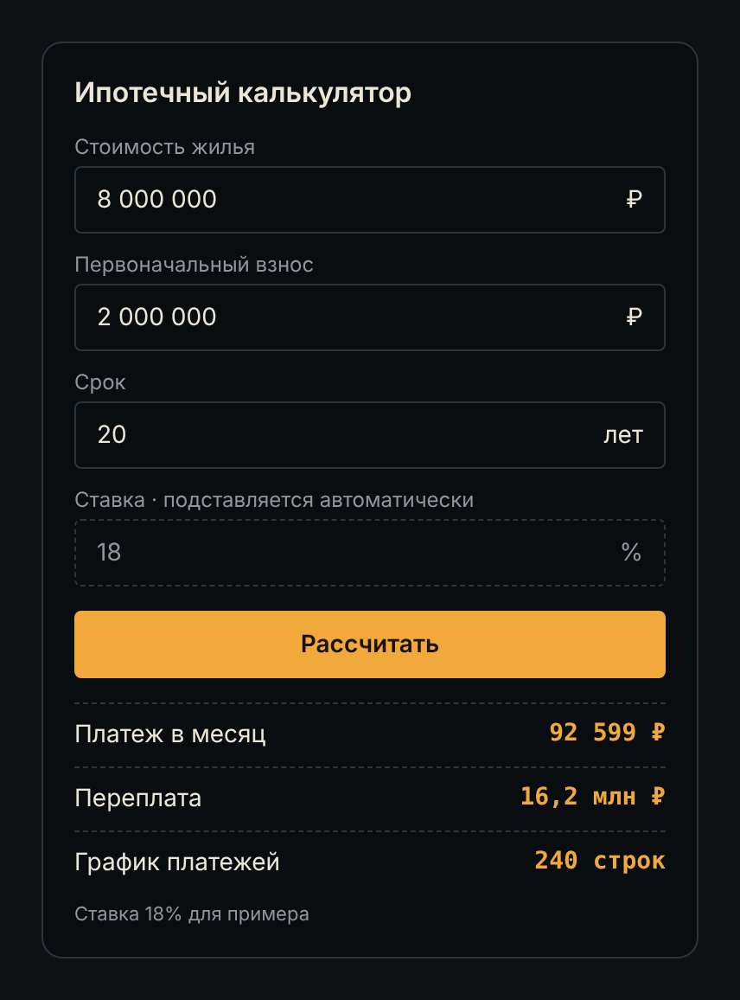

# 1. Требования

**Что это за артефакт.** Документ требований к фиче или сервису: цель, user stories, функциональные и нефункциональные требования и что не входит в версию.

## Цель

Клиент за минуту понимает ежемесячный платеж по ипотеке и сколько переплатит банку.

## User stories

1. Как клиент сервиса, я хочу видеть ежемесячный платеж по своим параметрам, чтобы понять, потяну ли я такой платеж.
2. Как клиент сервиса, я хочу видеть, сколько переплачу банку за весь срок, чтобы понимать реальную цену кредита.
3. Как клиент сервиса, я хочу видеть график платежей по месяцам, чтобы видеть, сколько из платежа уходит в долг, а сколько в проценты.

## Функциональные требования

1. Система рассчитывает ежемесячный платеж по стоимости жилья, первоначальному взносу и сроку.
2. Система подставляет актуальную ставку автоматически, клиент ее не вводит.
3. Система показывает переплату за весь срок.
4. Система показывает график платежей по месяцам.
5. Если взнос больше или равен стоимости жилья, система подсвечивает поле взноса и показывает ошибку "Взнос должен быть меньше стоимости жилья".
6. Взнос не меньше 20% стоимости жилья, иначе ошибка у поля взноса. *(добавлено после реализации)*
7. Срок кредита не больше 30 лет, иначе ошибка у поля срока. *(добавлено после реализации)*

## Нефункциональные требования

1. **Время отклика:** результат появляется не дольше 1 секунды после нажатия "Рассчитать".
2. **Производительность:** расчет с графиком на 360 месяцев занимает на сервере не больше 200 мс.
3. **Количество запросов:** сервис держит до 100 расчетов в секунду в пике без роста времени отклика.
4. **Доступность:** калькулятор доступен 99,5% времени в месяц.
5. **Безопасность:** обмен данными только по HTTPS; калькулятор не запрашивает и не хранит персональные данные.

*Цифры в пунктах 2-4 для примера, на проекте их согласуют с заказчиком.*

## Не входит в первую версию

- Досрочное погашение
- Сравнение ставок банков
- Одобрение ипотеки (решает банк)

## Варианты использования (use cases)

- Клиент вводит параметры кредита
- Клиент рассчитывает платеж
- Клиент смотрит переплату
- Клиент смотрит график платежей
- Клиент исправляет ошибку ввода

## Экран по требованиям

| Поле | Значение |
|---|---|
| Стоимость жилья | 8 000 000 ₽ |
| Первоначальный взнос | 2 000 000 ₽ |
| Срок | 20 лет |
| Ставка (подставляется автоматически, только чтение) | 18% |
| **Кнопка** | Рассчитать |
| Платеж в месяц | 92 599 ₽ |
| Переплата | 16,2 млн ₽ |
| График платежей | 240 строк |

*Ставка 18% для примера.*

## Прототип экрана

