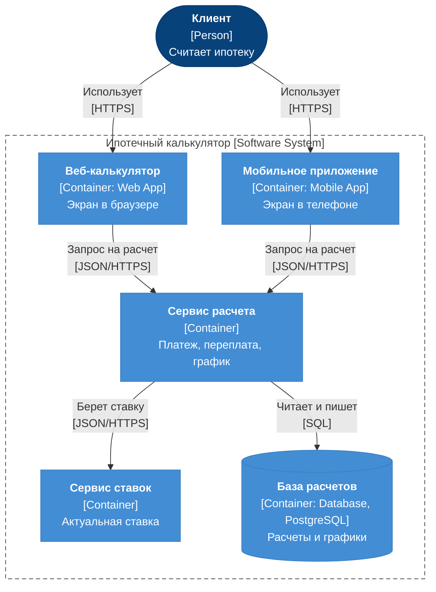

# 2. Архитектура в C4

**Что это за артефакт.** Диаграмма контейнеров C4 по системе и по одной строке про каждый контейнер.

## Диаграмма контейнеров

## Контейнеры

| Контейнер | Что делает | База |
|---|---|---|
| Веб-калькулятор, мобильное приложение | Принимают параметры от клиента и показывают результат | не нужна |
| Сервис расчета | Считает платеж, переплату и график по одной формуле для всех каналов | реляционная |
| Сервис ставок | Отдает актуальную ставку, чтобы клиент не вводил ее наугад | реляционная или ключ-значение |
| База расчетов | Хранит расчеты и графики, чтобы клиент мог к ним вернуться | PostgreSQL |

**Вне системы:** кредитное бюро, выдача ипотеки, авторизация, рассылки, админ-панель банка.
