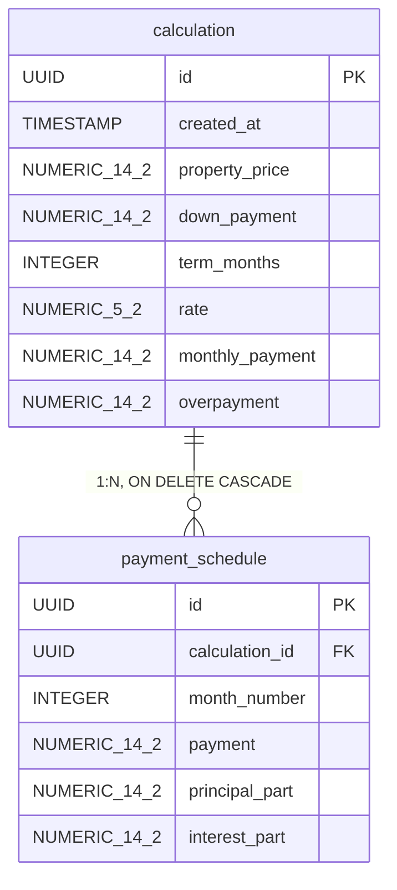

# 3. Модель данных

**Что это за артефакт.** Модель данных: таблицы, типы, связи и ключи сущностей, которые хранит сервис, плюс типовые запросы.

> Задача от заказчика: "Клиент должен вернуться через неделю и увидеть свой расчет целиком: параметры, платеж, переплату и график по месяцам. Персональные данные нам не нужны".

## ER-схема



*NUMERIC_14_2 означает NUMERIC(14,2): в Mermaid нельзя писать скобки в типе.*

## Пример данных

Квартира за 8 000 000 ₽, взнос 2 000 000 ₽, срок 20 лет, ставка 18%.

**calculation**

| property_price | down_payment | term_months | rate | monthly_payment | overpayment |
|---|---|---|---|---|---|
| 8 000 000 ₽ | 2 000 000 ₽ | 240 | 18% | 92 599 ₽ | 16 223 686 ₽ |

**payment_schedule**

| month_number | payment | principal_part | interest_part |
|---|---|---|---|
| 1 | 92 599 ₽ | 2 599 ₽ | 90 000 ₽ |
| 2 | 92 599 ₽ | 2 638 ₽ | 89 961 ₽ |
| 3 | 92 599 ₽ | 2 677 ₽ | 89 921 ₽ |
| ... | ... еще 237 строк | | |

## SQL: создать, прочитать, обновить, удалить

```sql
-- Создать расчет
INSERT INTO calculation (id, created_at, property_price, down_payment,
  term_months, rate, monthly_payment, overpayment)
VALUES ('3f9c2a1e-7b4d-4e8a-9c61-2d5f0b8e4a17', now(), 8000000.00, 2000000.00, 240, 18.00, 92598.69, 16223685.94);

INSERT INTO payment_schedule (calculation_id, month_number, payment, principal_part, interest_part)
VALUES ('3f9c2a1e-7b4d-4e8a-9c61-2d5f0b8e4a17', 1, 92598.69, 2598.69, 90000.00),
       ('3f9c2a1e-7b4d-4e8a-9c61-2d5f0b8e4a17', 2, 92598.69, 2637.67, 89961.02);
-- ... и еще 238 строк

-- Прочитать расчет, когда клиент вернулся
SELECT c.monthly_payment, c.overpayment, s.month_number, s.payment
FROM calculation c
JOIN payment_schedule s ON s.calculation_id = c.id
WHERE c.id = '3f9c2a1e-7b4d-4e8a-9c61-2d5f0b8e4a17'
ORDER BY s.month_number;

-- Обновить расчет: клиент пересчитал по новой ставке 17,5%
UPDATE calculation
SET rate = 17.50, monthly_payment = 90296.52, overpayment = 15671163.78
WHERE id = '3f9c2a1e-7b4d-4e8a-9c61-2d5f0b8e4a17';
-- строки графика сервис пересчитывает тем же расчетом

-- Удалить расчет: строки графика удалятся каскадом
DELETE FROM calculation WHERE id = '3f9c2a1e-7b4d-4e8a-9c61-2d5f0b8e4a17';
```
