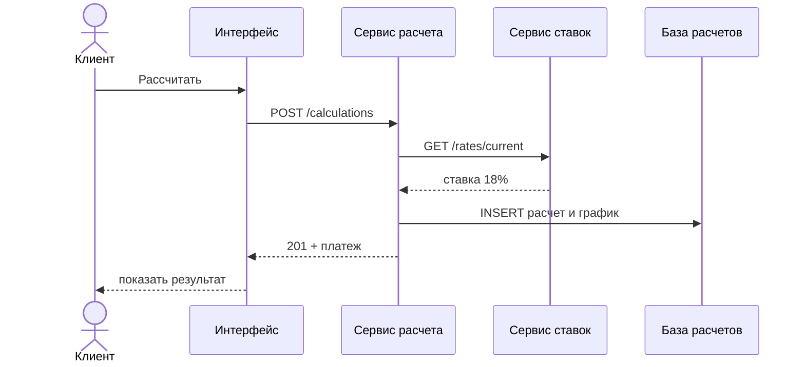

# 4. Описание API

**Что это за артефакт.** Описание одного метода API, его спецификация в OpenAPI и диаграмма, как он вызывается.

> Задача от заказчика: "Клиент вводит стоимость жилья, взнос и срок и нажимает "Рассчитать". Интерфейс должен отправить параметры в сервис расчета и получить платеж, переплату и график. Сервис сам берет актуальную ставку и сохраняет расчет в базу, чтобы клиент мог к нему вернуться. Опиши, как интерфейс и сервис договариваются".

## Диаграмма последовательности



## Описание метода

```
POST /calculations

Запрос
{
  "propertyPrice": 8000000,
  "downPayment": 2000000,
  "termMonths": 240
}

Ответ 201 Created
{
  "calculationId": "3f9c2a1e-7b4d-4e8a-9c61-2d5f0b8e4a17",
  "monthlyPayment": 92599,
  "overpayment": 16223686,
  "schedule": [
    { "month": 1, "payment": 92599, "principal": 2599, "interest": 90000 },
    ...
  ]
}

Ответ 400 Bad Request
{ "error": "Взнос должен быть меньше стоимости жилья" }
{ "error": "Взнос должен быть не меньше 20% стоимости жилья" }
{ "error": "Срок кредита не больше 30 лет" }
```

## Логика обработки запроса POST /calculations

Сервис расчета получает запрос от интерфейса и обрабатывает его по шагам. Если проверка не прошла, сервис сразу отвечает ошибкой и дальше не идет. В ответ уходит первая найденная ошибка.

### Шаг 1. Проверка формата запроса

Сервис проверяет поля по порядку: propertyPrice, downPayment, termMonths. Все три поля обязательны (required в спецификации).

| № | Условие | Ответ |
|---|---|---|
| 1.1 | Поля нет в запросе | 400, "Поле <имя поля> обязательно" |
| 1.2 | propertyPrice или downPayment не число | 400, "Поле <имя поля> должно быть числом" |
| 1.3 | termMonths не целое число | 400, "Поле termMonths должно быть целым числом" |
| 1.4 | termMonths меньше 1 | 400, "Срок кредита должен быть не меньше 1 месяца" |

Пример: `{ "error": "Поле propertyPrice обязательно" }`

### Шаг 2. Проверка бизнес-правил

| № | Условие | Ответ |
|---|---|---|
| 2.1 | downPayment ≥ propertyPrice | 400, "Взнос должен быть меньше стоимости жилья" |
| 2.2 | downPayment < 20% от propertyPrice | 400, "Взнос должен быть не меньше 20% стоимости жилья" |
| 2.3 | termMonths > 360 | 400, "Срок кредита не больше 30 лет" |

Правило 2.2 проверяется только тогда, когда прошло 2.1. Если неверны и взнос, и срок, клиент сначала получит ошибку про взнос.

### Шаг 3. Получение ставки

Сервис расчета запрашивает актуальную ставку у сервиса ставок: GET /rates/current. Клиент ставку не передает, ее всегда берет сервис.

Если сервис ставок не ответил или вернул ошибку → 500, "Не удалось выполнить расчет. Попробуйте позже".

### Шаг 4. Расчет

- Сумма кредита: S = propertyPrice - downPayment
- Месячная ставка: r = ставка / 12 / 100
- Ежемесячный платеж (аннуитетный): P = S × r / (1 - (1 + r)^(-termMonths))
- Переплата: P × termMonths - S
- График по каждому месяцу:
  - проценты = остаток долга × r;
  - в счет долга = P - проценты;
  - новый остаток = остаток - в счет долга.

### Шаг 5. Сохранение

Сервис создает calculationId (UUID) и записывает данные в базу расчетов:

- одну строку в calculation с параметрами, ставкой, платежом и переплатой;
- строки графика в payment_schedule, по одной на месяц (для 240 месяцев это 240 строк).

Если запись в базу не удалась → 500, "Не удалось выполнить расчет. Попробуйте позже".

### Шаг 6. Ответ

201 Created, в теле calculationId, monthlyPayment, overpayment и schedule.

### Сводка ответов

| Ситуация | Код | Тело ответа |
|---|---|---|
| Расчет выполнен и сохранен | 201 Created | calculationId, monthlyPayment, overpayment, schedule |
| Нет обязательного поля, неверный тип или срок меньше 1 месяца | 400 Bad Request | error: текст правила из шага 1 |
| Нарушено правило 2.1, 2.2 или 2.3 | 400 Bad Request | error: текст правила из шага 2 |
| Сервис ставок не ответил или не удалась запись в базу | 500 Internal Server Error | error: "Не удалось выполнить расчет. Попробуйте позже" |

## Спецификация openapi.yaml

```yaml
openapi: 3.0.3
info:
  title: Mortgage Calculator API
  version: 1.0.0
paths:
  /calculations:
    post:
      summary: Рассчитать ипотеку и сохранить расчет
      requestBody:
        required: true
        content:
          application/json:
            schema:
              $ref: '#/components/schemas/CalculationRequest'
      responses:
        '201':
          description: Расчет создан
          content:
            application/json:
              schema:
                $ref: '#/components/schemas/CalculationResponse'
        '400':
          description: Неверные параметры расчета
          content:
            application/json:
              schema:
                $ref: '#/components/schemas/Error'
components:
  schemas:
    CalculationRequest:
      type: object
      required: [propertyPrice, downPayment, termMonths]
      properties:
        propertyPrice:
          type: number
          example: 8000000
        downPayment:
          type: number
          example: 2000000
        termMonths:
          type: integer
          minimum: 1
          maximum: 360
          example: 240
    CalculationResponse:
      type: object
      properties:
        calculationId:
          type: string
          format: uuid
        monthlyPayment:
          type: number
          example: 92599
        overpayment:
          type: number
          example: 16223686
        schedule:
          type: array
          items:
            $ref: '#/components/schemas/ScheduleRow'
    ScheduleRow:
      type: object
      properties:
        month:
          type: integer
        payment:
          type: number
        principal:
          type: number
        interest:
          type: number
    Error:
      type: object
      properties:
        error:
          type: string
          example: Взнос должен быть меньше стоимости жилья
```

## Результат расчета

| Показатель | Значение |
|---|---|
| Платеж в месяц | 92 599 ₽ |
| Переплата | 16 223 686 ₽ |
| Срок | 240 мес. |

---

[← К обзору проекта](Портфолио.md)
