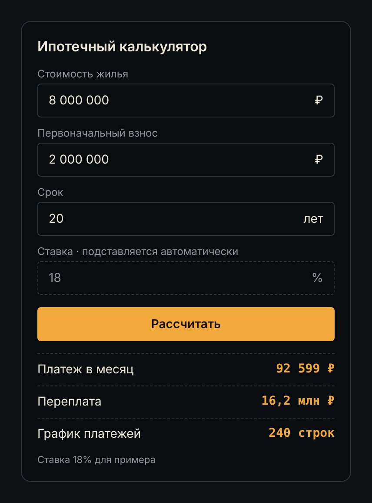
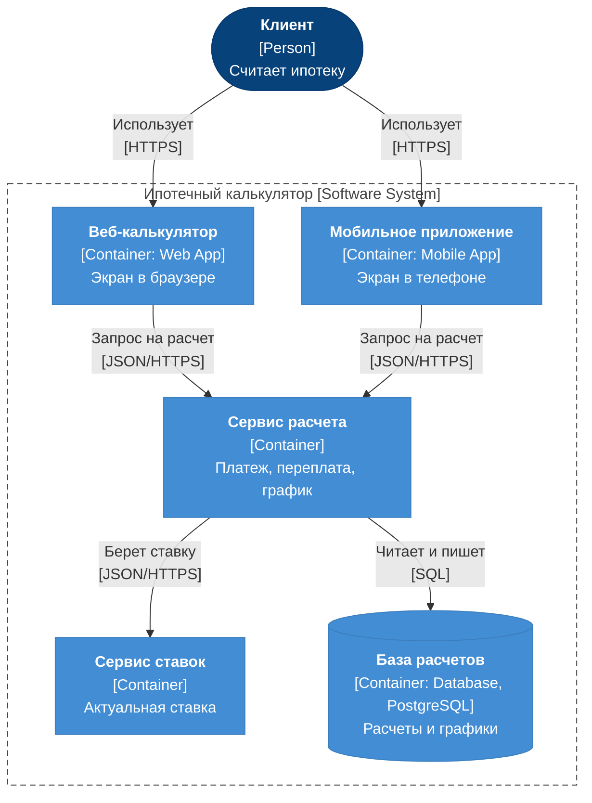
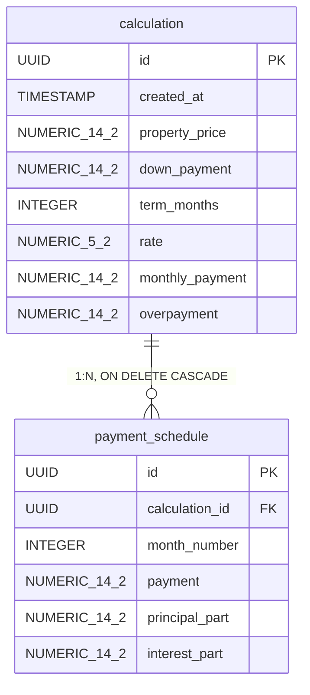
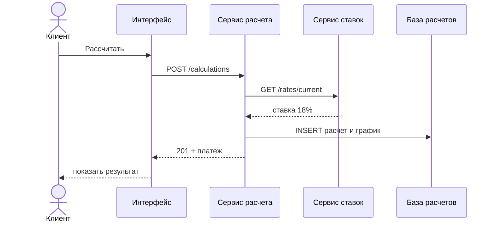

# Портфолио системного аналитика: ипотечный калькулятор


**Проект:** ипотечный калькулятор для банка
**Роль:** системный аналитик
**Что сделано:** путь от размытого запроса заказчика до работающего API - требования, архитектура, модель данных, интеграции

> Исходный запрос заказчика: "Нужен удобный ипотечный калькулятор, чтобы клиент быстро понял, сколько будет платить в месяц и сколько переплатит банку". И к нему 8 хотелок.

## Содержание

1. [Требования](#1-требования-v1)
2. [Архитектура](#2-архитектура-в-c4)
3. [Модель данных](#3-модель-данных)
4. [Описание API](#4-описание-api)

---

## 1. Требования 

**Что это за артефакт.** Документ требований к фиче или сервису: цель, user stories, функциональные и нефункциональные требования и что не входит в версию.

### Цель

Клиент за минуту понимает ежемесячный платеж по ипотеке и сколько переплатит банку.

### User stories

1. Как клиент сервиса, я хочу видеть ежемесячный платеж по своим параметрам, чтобы понять, потяну ли я такой платеж.
2. Как клиент сервиса, я хочу видеть, сколько переплачу банку за весь срок, чтобы понимать реальную цену кредита.
3. Как клиент сервиса, я хочу видеть график платежей по месяцам, чтобы видеть, сколько из платежа уходит в долг, а сколько в проценты.

### Функциональные требования

1. Система рассчитывает ежемесячный платеж по стоимости жилья, первоначальному взносу и сроку.
2. Система подставляет актуальную ставку автоматически, клиент ее не вводит.
3. Система показывает переплату за весь срок.
4. Система показывает график платежей по месяцам.
5. Если взнос больше или равен стоимости жилья, система подсвечивает поле взноса и показывает ошибку "Взнос должен быть меньше стоимости жилья".
6. Взнос не меньше 20% стоимости жилья, иначе ошибка у поля взноса. *(добавлено после реализации)*
7. Срок кредита не больше 30 лет, иначе ошибка у поля срока. *(добавлено после реализации)*

### Нефункциональные требования

1. **Время отклика:** результат появляется не дольше 1 секунды после нажатия "Рассчитать".
2. **Производительность:** расчет с графиком на 360 месяцев занимает на сервере не больше 200 мс.
3. **Количество запросов:** сервис держит до 100 расчетов в секунду в пике без роста времени отклика.
4. **Доступность:** калькулятор доступен 99,5% времени в месяц.
5. **Безопасность:** обмен данными только по HTTPS; калькулятор не запрашивает и не хранит персональные данные.

*Цифры в пунктах 2-4 для примера, на проекте их согласуют с заказчиком.*

### Не входит в первую версию

- Досрочное погашение
- Сравнение ставок банков
- Одобрение ипотеки (решает банк)

### Варианты использования (use cases)

- Клиент вводит параметры кредита
- Клиент рассчитывает платеж
- Клиент смотрит переплату
- Клиент смотрит график платежей
- Клиент исправляет ошибку ввода

### Экран по требованиям

| Поле | Значение |
|---|---|
| Стоимость жилья | 8 000 000 ₽ |
| Первоначальный взнос | 2 000 000 ₽ |
| Срок | 20 лет |
| Ставка (подставляется автоматически, только чтение) | 18% |
| **Кнопка** | Рассчитать |
| Платеж в месяц | 92 599 ₽ |
| Переплата | 16,2 млн ₽ |
| График платежей | 240 строк |

*Ставка 18% для примера.*

### Прототип экрана



---

## 2. Архитектура в C4

**Что это за артефакт.** Диаграмма контейнеров C4 по системе и по одной строке про каждый контейнер.

### Диаграмма контейнеров



### Контейнеры

| Контейнер | Что делает | База |
|---|---|---|
| Веб-калькулятор, мобильное приложение | Принимают параметры от клиента и показывают результат | не нужна |
| Сервис расчета | Считает платеж, переплату и график по одной формуле для всех каналов | реляционная |
| Сервис ставок | Отдает актуальную ставку, чтобы клиент не вводил ее наугад | реляционная или ключ-значение |
| База расчетов | Хранит расчеты и графики, чтобы клиент мог к ним вернуться | PostgreSQL |

**Вне системы:** кредитное бюро, выдача ипотеки, авторизация, рассылки, админ-панель банка.

---

## 3. Модель данных

**Что это за артефакт.** Модель данных: таблицы, типы, связи и ключи сущностей, которые хранит сервис, плюс типовые запросы.

> Задача от заказчика: "Клиент должен вернуться через неделю и увидеть свой расчет целиком: параметры, платеж, переплату и график по месяцам. Персональные данные нам не нужны".

### ER-схема



*NUMERIC_14_2 означает NUMERIC(14,2): в Mermaid нельзя писать скобки в типе.*

### Пример данных

Квартира за 8 000 000 ₽, взнос 2 000 000 ₽, срок 20 лет, ставка 18%.

**calculation**

| property_price | down_payment | term_months | rate | monthly_payment | overpayment |
|---|---|---|---|---|---|
| 8 000 000 ₽ | 2 000 000 ₽ | 240 | 18% | 92 599 ₽ | 16 223 686 ₽ |

**payment_schedule**

| month_number | payment | principal_part | interest_part |
|---|---|---|---|
| 1 | 92 599 ₽ | 2 599 ₽ | 90 000 ₽ |
| 2 | 92 599 ₽ | 2 638 ₽ | 89 961 ₽ |
| 3 | 92 599 ₽ | 2 677 ₽ | 89 921 ₽ |
| ... | ... еще 237 строк | | |

### SQL: создать, прочитать, обновить, удалить

```sql
-- Создать расчет
INSERT INTO calculation (id, created_at, property_price, down_payment,
  term_months, rate, monthly_payment, overpayment)
VALUES ('3f9c2a1e-7b4d-4e8a-9c61-2d5f0b8e4a17', now(), 8000000.00, 2000000.00, 240, 18.00, 92598.69, 16223685.94);

INSERT INTO payment_schedule (calculation_id, month_number, payment, principal_part, interest_part)
VALUES ('3f9c2a1e-7b4d-4e8a-9c61-2d5f0b8e4a17', 1, 92598.69, 2598.69, 90000.00),
       ('3f9c2a1e-7b4d-4e8a-9c61-2d5f0b8e4a17', 2, 92598.69, 2637.67, 89961.02);
-- ... и еще 238 строк

-- Прочитать расчет, когда клиент вернулся
SELECT c.monthly_payment, c.overpayment, s.month_number, s.payment
FROM calculation c
JOIN payment_schedule s ON s.calculation_id = c.id
WHERE c.id = '3f9c2a1e-7b4d-4e8a-9c61-2d5f0b8e4a17'
ORDER BY s.month_number;

-- Обновить расчет: клиент пересчитал по новой ставке 17,5%
UPDATE calculation
SET rate = 17.50, monthly_payment = 90296.52, overpayment = 15671163.78
WHERE id = '3f9c2a1e-7b4d-4e8a-9c61-2d5f0b8e4a17';
-- строки графика сервис пересчитывает тем же расчетом

-- Удалить расчет: строки графика удалятся каскадом
DELETE FROM calculation WHERE id = '3f9c2a1e-7b4d-4e8a-9c61-2d5f0b8e4a17';
```

---

## 4. Описание API

**Что это за артефакт.** Описание одного метода API, его спецификация в OpenAPI и диаграмма, как он вызывается.

> Задача от заказчика: "Клиент вводит стоимость жилья, взнос и срок и нажимает "Рассчитать". Интерфейс должен отправить параметры в сервис расчета и получить платеж, переплату и график. Сервис сам берет актуальную ставку и сохраняет расчет в базу, чтобы клиент мог к нему вернуться. Опиши, как интерфейс и сервис договариваются".

### Диаграмма последовательности



### Описание метода

```
POST /calculations

Запрос
{
  "propertyPrice": 8000000,
  "downPayment": 2000000,
  "termMonths": 240
}

Ответ 201 Created
{
  "calculationId": "3f9c2a1e-7b4d-4e8a-9c61-2d5f0b8e4a17",
  "monthlyPayment": 92599,
  "overpayment": 16223686,
  "schedule": [
    { "month": 1, "payment": 92599, "principal": 2599, "interest": 90000 },
    ...
  ]
}

Ответ 400 Bad Request
{ "error": "Взнос должен быть меньше стоимости жилья" }
{ "error": "Взнос должен быть не меньше 20% стоимости жилья" }
{ "error": "Срок кредита не больше 30 лет" }
```

### Спецификация openapi.yaml

```yaml
openapi: 3.0.3
info:
  title: Mortgage Calculator API
  version: 1.0.0
paths:
  /calculations:
    post:
      summary: Рассчитать ипотеку и сохранить расчет
      requestBody:
        required: true
        content:
          application/json:
            schema:
              $ref: '#/components/schemas/CalculationRequest'
      responses:
        '201':
          description: Расчет создан
          content:
            application/json:
              schema:
                $ref: '#/components/schemas/CalculationResponse'
        '400':
          description: Неверные параметры расчета
          content:
            application/json:
              schema:
                $ref: '#/components/schemas/Error'
components:
  schemas:
    CalculationRequest:
      type: object
      required: [propertyPrice, downPayment, termMonths]
      properties:
        propertyPrice:
          type: number
          example: 8000000
        downPayment:
          type: number
          example: 2000000
        termMonths:
          type: integer
          minimum: 1
          maximum: 360
          example: 240
    CalculationResponse:
      type: object
      properties:
        calculationId:
          type: string
          format: uuid
        monthlyPayment:
          type: number
          example: 92599
        overpayment:
          type: number
          example: 16223686
        schedule:
          type: array
          items:
            $ref: '#/components/schemas/ScheduleRow'
    ScheduleRow:
      type: object
      properties:
        month:
          type: integer
        payment:
          type: number
        principal:
          type: number
        interest:
          type: number
    Error:
      type: object
      properties:
        error:
          type: string
          example: Взнос должен быть меньше стоимости жилья
```

### Результат расчета

| Показатель | Значение |
|---|---|
| Платеж в месяц | 92 599 ₽ |
| Переплата | 16 223 686 ₽ |
| Срок | 240 мес. |


